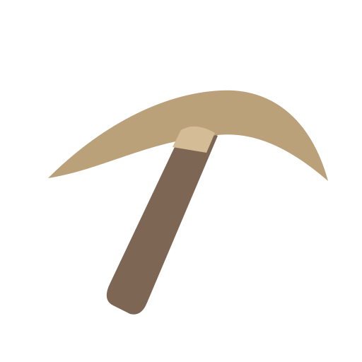

  
  <h1>DiggerTerm</h1>
  
A desktop workspace for multiple terminals, with sessions hosted by a background daemon

  

    <a href="README.md">简体中文</a> ·
    <a href="https://github.com/xswt442-cmd/DiggerTerm/releases">Releases</a> ·
    <a href="CHANGELOG.md">Changelog</a>
  

  

    
    
    
  

## Download

Download the Windows x64, Linux x64, or Ubuntu / Debian x64 packages and SHA-256 checksums from [GitHub Releases](https://github.com/xswt442-cmd/DiggerTerm/releases/latest).

## Features

- **Multiple terminals:** sidebar navigation, search, rename, nested horizontal/vertical splits, draggable dividers and layout restore; closing a pane keeps its session running.
- **Focus mode:** hide workspace controls and show only the active terminal; context menus, mouse reporting, keyboard input, and link activation pass through to the terminal application while DiggerTerm pane splits, session switching, the command palette, Quick CD, search, and copy overlays are unavailable. The narrow sidebar keeps the exit control and a terminal-only appearance settings page.
- **Local and remote shells:** PowerShell, CMD, Git Bash (requires Git for Windows), WSL, Linux Bash, and SSH.
- **Quick CD:** select a managed terminal and click Quick CD or press `Ctrl+Shift+G`. Local sessions can choose a folder through the native OS dialog; SSH sessions have a separate read-only remote directory browser. Paths may also be typed manually. The command is quoted for the shell type and executed on click; a local path can become the new-session default.
- **Workspace information:** favorite paths and recall recently sent directories in Quick CD; add notes and colors to sessions. Session presets save a local shell and starting directory or an SSH host and port for later use.
- **Persistent sessions:** the daemon keeps sessions running after the GUI exits; reconnect on restart.
- **Dig process tree:** browse discovered shells, agents and descendants by Windows/WSL distribution, expand and filter the tree, and inspect read-only details without taking control.
- **Preferences:** dark themes, fonts, sizes, language, default shell, and working directory.
- **Update checks:** check the latest GitHub release in the background at most once every 24 hours, with an opt-out in Help and a download entry when an update is available.

In smart mode, **Ctrl+C** copies when there is a selection and interrupts when there is none; full-screen applications such as nano keep their native control keys. The terminal toolbar and context menu provide Copy, Paste and a read-only copy mode. Try **Shift-drag** in terminals that report mouse events (Option on macOS), and use copy mode when the selection does not take. Shortcuts are recorded in Settings → Keys ([example](examples/keybindings.json)).

## Notes

Themes and keys: copy the [example JSON/CSS files](examples/themes/) into `DiggerTerm/` under your user's home directory, then refresh Settings → Appearance to pick one. A JSON `name` is the display name, and `custom.css` overrides styling globally. Shortcuts are stored as `keybindings.json` in the same directory.

The Windows installer creates a Start menu shortcut and Explorer folder context menus for the current user (on Windows 11 they may sit under "Show more options"); right-clicking a folder and choosing "Open in DiggerTerm" opens a PowerShell session in that folder. Uninstall removes these entries and keeps your data. "DiggerTerm (Administrator)" in the Start menu opens an elevated window with its own daemon and sessions; elevation does not extend to remote SSH users or to Linux users inside WSL. Windows requires WebView2, and the packages are unsigned.

Linux packages are built for Ubuntu 24.04; other distributions need their own GTK4 and WebKitGTK 6 dependencies. Sessions are not guaranteed to survive a daemon crash or a system reboot.

Quick CD sends a quoted `cd` and Enter to the managed terminal. Use it only at an empty prompt: not while `vim`, an Agent, or another foreground program is running, and not when the prompt already holds input. Read-only processes listed under Dig do not offer it.

Favorites, directory history, session notes and colors, and presets live in the local GUI only. A recent directory means the command was sent, not that the shell changed. SSH directories are isolated per session; SSH presets store no password and do not change remote directories.

Windows drive folders are converted to WSL `/mnt/c/...` or Git Bash `/c/...` paths; custom mounts and Linux-only paths must be typed. The SSH directory browser uses a separate OpenSSH connection and needs a POSIX-compatible remote shell plus noninteractive key or SSH Agent authentication; password-only targets can still be entered by hand.

Update checks read only the release version and never download or replace the program silently. New features need a matching daemon version, so finish existing sessions and exit the old daemon before upgrading or uninstalling. Reconnecting restores recent terminal output; long-running full-screen applications may come back incomplete.

## License

[MIT](LICENSE).
